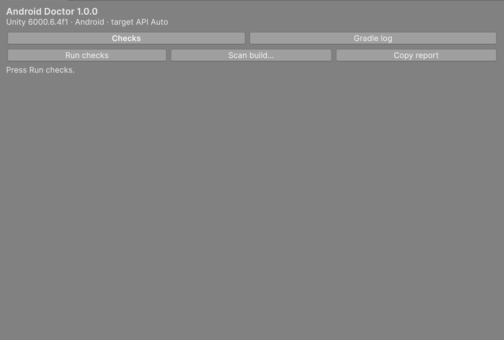

# Android Doctor

Finds why your Unity Android build fails or gets rejected by Google Play, and fixes the common causes with one click.



Free, open source (MIT). One window: **Window > Android Doctor**.

## Install

Window > Package Manager > + > Add package from git URL…

```text
https://github.com/MValera-Dev/android-doctor.git?path=/Packages/com.mvalera_dev.androiddoctor
```

Or download the `.zip` of the package from the GitHub Releases page, unzip it, and use *Add package from disk…* on its `package.json`.

## How to use it

1. Open **Window > Android Doctor** and press **Check project**. It looks at your Android tools, your Player Settings, your native libraries and, if your last build failed in Gradle, the reason.
2. Read the sentence at the top: *"2 problems will stop your build"*, or *"Ready to build"*.
3. Press **Fix all**. It lists every change first and asks before it does anything. Files it edits are copied to `Library/AndroidDoctor/Backups` beforehand.
4. Anything that needs a decision of yours stays as a row with its own buttons, for example which version of a duplicated library to keep.

Nothing runs until you press a button.

## What one click fixes

| Problem | What the button does |
|---|---|
| A custom JDK, SDK, NDK or Gradle that does not match Unity | Goes back to the ones installed with Unity |
| Gradle runs out of memory (`Java heap space`, or less than 2 GB for Gradle) | Raises the heap in Preferences > External Tools |
| Target API below the Google Play minimum, Min API too low, no ARM64 / IL2CPP | Sets them |
| `android:exported` missing in a manifest (an error since API 31) | Adds it, choosing true or false from what the component is |
| `gradleTemplate.properties` still sets a setting Gradle removed (`Failed to apply plugin`) | Rewrites the setting |
| A library needs a higher Min API than your project | Sets exactly the level the library declares |
| `ANDROID_SDK_HOME` is set and breaks the Android plugin | Ignores it while Unity is open |
| An old Burst package (16 KB libraries) | Updates it through Package Manager |

**Fix all** only includes changes that need no decision from you.

## When it needs your decision

- **Duplicate libraries** (`Duplicate class`, two plugins with the same `.so`): one button per version, "keep 1.10.0, turn the others off". The others are switched off for Android in the plugin's import settings; nothing is deleted and one checkbox undoes it.
- **Custom Gradle templates**: back them up and remove them so Unity uses its own.
- **External Dependency Manager**: reset its resolved libraries, when it is installed.
- **A build that fails and nothing is recognised**: clean the generated Android project.
- **Build App Bundle** and **Player Settings**: turn on the App Bundle, or open the settings.

## What it only explains

Some problems have no safe button, so it says what happens and what to do:

- A missing SDK platform or build-tools: it copies the `sdkmanager` command. It does not install them (see Limitations).
- Network, proxy or certificate problems while Gradle downloads.
- A wrong keystore password.
- Native libraries from a third-party package that are not 16 KB aligned: it names the package that ships them. Updating or replacing the package is up to you.
- A manifest attribute that two libraries set differently, and Java compile errors.

## Reading a finding

Each row has the Console's icon for its severity, the problem in bold, what to do, the rule id on the right (useful to search or report) and an *Evidence* line with the exact paths and versions it found.

## Reporting a bug or a missing detection

Press **Copy report** and paste the result in an issue. It is Markdown, always in English, and holds your Unity, OS, JDK, NDK and Gradle versions plus the findings. For a Gradle error that is not recognised, use the *Gradle log* tab: paste the log and press **Copy for forum**.

A false positive becomes a test before it is fixed, and a new Gradle error becomes a pattern with its own fixture.

## Limitations

- Developed and tested on **Unity 6000.6.4f1 on Windows 11**. `package.json` declares Unity 2022.3 as the minimum, but it has not been run there yet. macOS and Linux are untested.
- It cannot install missing SDK platforms or build-tools. The SDK that ships with Unity is in `Program Files` on Windows and is not writable without administrator rights, which this tool does not try to get.
- The fixes are covered by tests with real files, and one complete flow was checked with a real Android build (a project with a removed Gradle setting, Fix all, a successful build). Updating Burst and resetting the External Dependency Manager were not exercised against a real registry or a real EDM4U yet.
- The compatibility table (`Editor/Data/compat.json`) and the Google Play requirements (`play.json`) are dated 2026-11-06. For a Unity version newer than the table, the closest older row is used.
- The Gradle patterns were checked against real failed builds on Unity 6000.6.4f1. Other Unity versions print slightly different logs, so a pattern may miss there.
- The tool never opens a network connection by itself. Package Manager and the External Dependency Manager do, when you press the buttons that use them.
- The ZIP alignment of uncompressed `.so` files inside an APK (BLD002) is not checked.

## Contributing

Issues and pull requests are welcome. Everything is in English except the Spanish tables in `Editor/Core/Messages.cs` and `Editor/Core/Messages.Fixes.cs`. Tests are in `Packages/com.mvalera_dev.androiddoctor/Tests/Editor` (Window > General > Test Runner > EditMode). The design is in `Docs/GDD.md` (in Spanish).

## License

MIT. See `LICENSE`.
